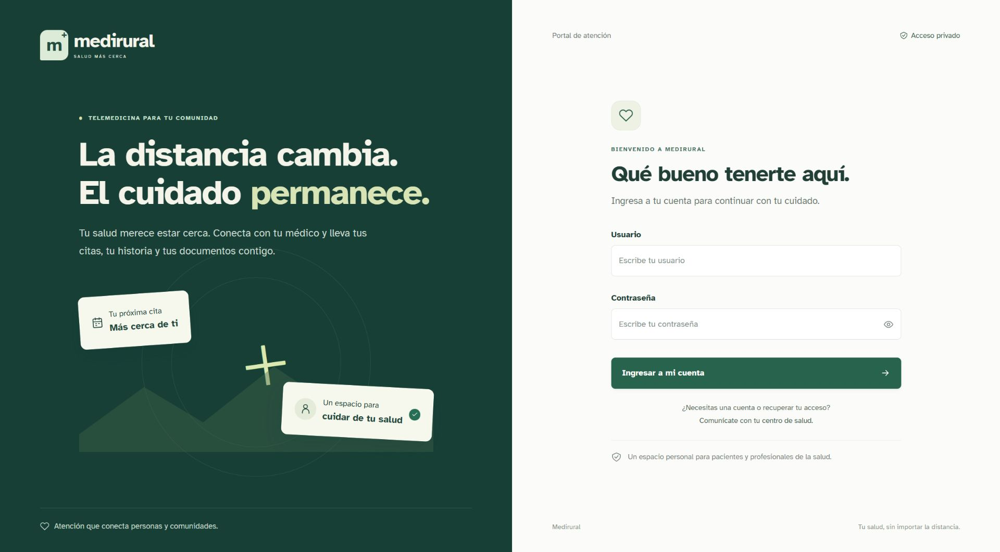
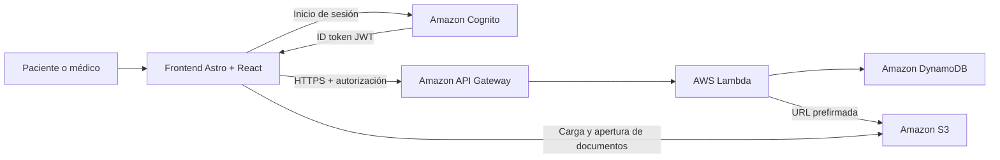

# Medirural

**Plataforma web de gestión de atención para telemedicina rural.**

Medirural permite a pacientes y profesionales de salud gestionar citas, consultar registros de atención y compartir documentos clínicos desde una interfaz adaptable a computadoras y dispositivos móviles. Su propósito es facilitar el seguimiento de la atención en comunidades donde los desplazamientos y el acceso a servicios de salud representan una barrera.

Este repositorio contiene el **frontend** de la solución. La autenticación, las reglas de autorización, la persistencia de datos y el almacenamiento de archivos se integran con servicios externos en AWS.



## Contenido

- [Alcance del producto](#alcance-del-producto)
- [Perfiles y funcionalidades](#perfiles-y-funcionalidades)
- [Arquitectura](#arquitectura)
- [Tecnologías](#tecnologías)
- [Requisitos](#requisitos)
- [Instalación y ejecución](#instalación-y-ejecución)
- [Configuración de entornos](#configuración-de-entornos)
- [Uso de la aplicación](#uso-de-la-aplicación)
- [Integración con la API](#integración-con-la-api)
- [Estructura del repositorio](#estructura-del-repositorio)
- [Pruebas y calidad](#pruebas-y-calidad)
- [Integración continua](#integración-continua)
- [Compilación y despliegue](#compilación-y-despliegue)
- [Seguridad y tratamiento de datos](#seguridad-y-tratamiento-de-datos)
- [Experiencia de usuario y accesibilidad](#experiencia-de-usuario-y-accesibilidad)
- [Solución de problemas](#solución-de-problemas)
- [Contribución](#contribución)
- [Evolución del producto](#evolución-del-producto)
- [Mantenimiento y licencia](#mantenimiento-y-licencia)

## Alcance del producto

Medirural ofrece un espacio de atención con tres módulos: **citas**, **historial clínico** y **documentos**. El acceso requiere una cuenta previamente habilitada en Amazon Cognito y un grupo compatible con el perfil del usuario.

La aplicación funciona conectada al backend: consultar o guardar información requiere conexión. El aviso de desconexión informa al usuario, pero no proporciona almacenamiento de operaciones pendientes ni sincronización offline.

La implementación actual no incluye videollamadas, autorregistro, recuperación de contraseña desde la interfaz, cancelación o reprogramación de citas, ni eliminación de notas o documentos. El envío de notificaciones por correo o SMS pertenece a los servicios del backend y no se administra desde este frontend.

## Perfiles y funcionalidades

| Funcionalidad | Paciente | Médico |
| --- | --- | --- |
| Iniciar y cerrar sesión | Sí | Sí |
| Consultar próximas citas y todas las citas | Citas propias | Agenda de atención |
| Solicitar una cita | Sí | No disponible en la interfaz |
| Consultar historial | Historial propio | Del paciente seleccionado desde una cita |
| Registrar una nota clínica | No disponible | Del paciente seleccionado |
| Consultar y cargar documentos | Documentos propios | Del paciente seleccionado |
| Cambiar el paciente de trabajo | No aplica | Desde la agenda o la acción de cambiar paciente |

La selección de paciente del médico se conserva al navegar entre historial y documentos dentro del panel. Al recargar la página debe seleccionarse nuevamente.

Esta tabla describe el comportamiento de la interfaz. El backend debe verificar los permisos de cada operación y el acceso a los datos de cada paciente.

### Reglas visibles en la interfaz

- **Citas:** fecha y hora futuras, usuario del médico obligatorio de hasta 128 caracteres y motivo obligatorio de hasta 500 caracteres.
- **Notas:** contenido obligatorio, sin admitir únicamente espacios, de hasta 5000 caracteres.
- **Documentos:** archivos con contenido, de hasta 10 MiB —10 × 1024 × 1024 bytes—, en formato PDF, JPEG, PNG o WebP. La interfaz presenta este límite como 10 MB.
- **Operaciones:** mensajes de carga, confirmación y error; bloqueo del botón de envío mientras se procesa la solicitud.

Estas validaciones del cliente deben complementarse con validaciones del servidor.

## Arquitectura

El frontend se compila como un sitio estático. Astro define las páginas y React controla las interacciones, los formularios y el estado de la sesión en el navegador.



| Componente | Responsabilidad |
| --- | --- |
| Astro | Páginas, estructura HTML y compilación estática. |
| React | Paneles, navegación interna, formularios y estados de interacción. |
| Amazon Cognito | Autenticación y emisión del token de identidad. |
| API Gateway y Lambda | Entrada a la API, operaciones de negocio y controles del backend. |
| DynamoDB | Persistencia de citas e historial en la arquitectura de servicios. |
| S3 | Almacenamiento de documentos mediante acceso temporal firmado. |

El código de Lambda, Terraform, la configuración de Cognito y el aprovisionamiento de AWS se administran fuera de este repositorio. Ejecutar el frontend no crea ni despliega esos recursos.

### Flujo de sesión

1. El usuario ingresa sus credenciales.
2. El frontend solicita autenticación a Cognito mediante `USER_PASSWORD_AUTH`.
3. Cognito devuelve un `IdToken` y la aplicación interpreta identidad, vigencia y grupos para presentar el panel.
4. El token se guarda en `sessionStorage` y acompaña las solicitudes a la API.
5. Si la sesión local deja de ser válida o la API devuelve HTTP 401, la aplicación redirige al acceso.
6. Al cerrar sesión, se elimina el token de la pestaña. Esta acción no implementa revocación global en Cognito.

### Flujo de documentos

1. El usuario selecciona un archivo compatible.
2. El frontend solicita una URL de carga con el nombre del archivo y el identificador del paciente.
3. El navegador envía el contenido con `PUT` a S3 mediante la URL prefirmada.
4. El listado se actualiza después de una carga exitosa.
5. Los documentos se abren en otra pestaña con la URL HTTPS devuelta por el backend.

## Tecnologías

| Tecnología | Uso |
| --- | --- |
| Node.js 24 | Entorno de desarrollo, pruebas y compilación. |
| npm y `package-lock.json` | Instalación reproducible de dependencias. |
| Astro 7 | Framework web y generación estática. |
| React 19 | Componentes interactivos. |
| Tailwind CSS 4 y CSS propio | Estilos, distribución y adaptación responsive. |
| Atkinson Hyperlegible | Tipografía distribuida con la aplicación. |
| Fetch API | Comunicación con Cognito, la API y S3. |
| Node.js Test Runner | Pruebas automatizadas de sesión y destinos de carga. |
| GitHub Actions | Ejecución de pruebas y compilación en CI. |

Los rangos de dependencias se encuentran en `package.json`; las versiones resueltas están en `package-lock.json`.

## Requisitos

- Node.js 24, de acuerdo con `.nvmrc`.
- npm incluido con la instalación de Node.js.
- Git para obtener el código y colaborar.
- Navegador actualizado con JavaScript y almacenamiento de sesión habilitados.
- Acceso de red a Cognito, API Gateway y S3.
- Backend disponible y cuentas de prueba aprovisionadas.

Para las cuentas de Cognito se requiere un app client compatible con `USER_PASSWORD_AUTH`, sin secreto de cliente en el navegador, y pertenencia al grupo `paciente` o `medico`. Los flujos de desafío, como cambio obligatorio de contraseña o MFA, requieren ampliación de la interfaz actual.

Verifica tu entorno:

```bash
node --version
npm --version
```

## Instalación y ejecución

### 1. Obtener el código

```bash
git clone https://github.com/hexag0n18/medicine.git
cd medicine
```

Si trabajas desde un fork, utiliza la URL de tu fork. Para abrir la carpeta con Visual Studio Code:

```bash
code .
```

### 2. Instalar dependencias

Con los servidores del proyecto detenidos:

```bash
npm ci
```

`npm ci` instala las versiones del lockfile y reemplaza la instalación existente. Utiliza `npm install` al modificar deliberadamente las dependencias y revisa el cambio correspondiente en `package-lock.json`.

### 3. Crear la configuración local

En PowerShell:

```powershell
Copy-Item .env.example .env
```

En Bash:

```bash
cp .env.example .env
```

Ejecuta la copia únicamente si todavía no tienes `.env`, para conservar la configuración existente. Completa las variables según el entorno antes de iniciar el servidor.

### 4. Iniciar desarrollo

```bash
npm run dev
```

Abre la URL indicada por Astro, normalmente `http://localhost:4321`. Detén el proceso con **Ctrl + C**.

### Comandos disponibles

| Comando | Descripción |
| --- | --- |
| `npm ci` | Instala las dependencias resueltas en el lockfile. |
| `npm run dev` | Inicia el servidor de desarrollo con recarga de cambios. |
| `npm test` | Ejecuta las pruebas automatizadas. |
| `npm run build` | Genera los archivos de producción en `dist/`. |
| `npm run preview` | Sirve localmente la compilación de producción. |

## Configuración de entornos

### Variables de entorno

| Variable | Obligatoria | Descripción |
| --- | --- | --- |
| `PUBLIC_COGNITO_URL` | Sí | Endpoint de Cognito o ruta local del emulador. |
| `PUBLIC_CLIENT_ID` | Sí | Identificador del app client de Cognito. |
| `PUBLIC_API_URL` | Sí | URL base de la API, sin barra final. |

Ejemplo para AWS real; reemplaza los valores entre `<...>`:

```dotenv
PUBLIC_COGNITO_URL=https://cognito-idp.us-east-2.amazonaws.com
PUBLIC_CLIENT_ID=<cognito-app-client-id>
PUBLIC_API_URL=https://<api-id>.execute-api.us-east-2.amazonaws.com
```

El archivo `.env.example` también describe la conexión con el emulador local. Los valores vacíos de la plantilla deben completarse; copiarla por sí solo no habilita el backend.

Las variables `PUBLIC_` se incorporan al código que recibe el navegador. Deben contener únicamente configuración pública. Las contraseñas, claves de AWS, secretos de cliente y tokens no deben almacenarse allí. `.env` está excluido de Git.

Después de cambiar variables, reinicia el servidor de desarrollo. En producción, vuelve a compilar y desplegar: las variables quedan incorporadas durante el build.

### Configuración de almacenamiento

El destino de carga está restringido actualmente a:

```text
Origen: https://s3.us-east-2.amazonaws.com
Prefijo: /telemedicina-documentos-968579693864/
```

Para conectar otro bucket o región, actualiza de forma coordinada:

- La validación de destino en `src/lib/upload.js`.
- El proxy de desarrollo en `astro.config.mjs`.
- Los casos de prueba en `tests/upload.test.js`.
- La generación de URLs prefirmadas y CORS del backend/S3.

Las tres variables de entorno del frontend no cambian por sí solas esta restricción del bucket.

### Producción y CORS

La compilación llama directamente a Cognito, API Gateway y S3. Deben autorizar el origen exacto del sitio publicado, incluyendo protocolo, dominio y puerto cuando corresponda.

- **API:** permitir los métodos utilizados y los encabezados `authorization` y `content-type`.
- **S3:** permitir `PUT` desde el origen del frontend y los encabezados enviados en la carga.
- **Vistas previas de despliegue:** revisar también su origen; permitir el dominio principal no habilita automáticamente todos los subdominios de preview.

`npm run preview` ejecuta la compilación de producción y no utiliza los proxies de `npm run dev`. Por ello, también necesita una configuración CORS compatible con su origen local.

## Uso de la aplicación

### Paciente

1. Ingresa con una cuenta habilitada.
2. Consulta la agenda y cambia entre próximas citas y todas las citas.
3. Para solicitar una cita, completa fecha, hora, usuario del médico y motivo.
4. Abre **Historial clínico** para consultar las notas de atención.
5. En **Documentos**, selecciona y carga un archivo. Espera la confirmación antes de abandonar la pantalla.
6. Cierra sesión al finalizar, especialmente en dispositivos compartidos.

### Médico

1. Ingresa con una cuenta perteneciente al grupo `medico`.
2. Revisa la agenda y selecciona **Ver historial** en una cita.
3. Consulta el historial del paciente y registra una nota cuando corresponda.
4. Navega a **Documentos** para consultar o cargar archivos del mismo paciente.
5. Utiliza **Cambiar paciente** para regresar a la selección desde la agenda.

## Integración con la API

Las rutas de negocio se resuelven sobre `PUBLIC_API_URL`. El cliente envía el ID token de Cognito en el encabezado `Authorization`, con el formato actual:

```http
Authorization: <IdToken>
Content-Type: application/json
```

`Content-Type` se agrega cuando existe un cuerpo JSON. El cliente actual envía el token directamente, sin anteponer `Bearer`; coordina cualquier cambio de este contrato con el autorizador del backend.

### Operaciones consumidas

| Método | Ruta | Operación | Cuerpo enviado |
| --- | --- | --- | --- |
| `GET` | `/citas` | Consultar la agenda accesible al usuario. | Sin cuerpo. |
| `POST` | `/citas` | Solicitar una cita. | `fecha`, `medico`, `motivo`. |
| `GET` | `/historiales/{pacienteId}` | Consultar notas del paciente. | Sin cuerpo. |
| `POST` | `/historiales/{pacienteId}` | Registrar una nota. | `nota`. |
| `GET` | `/documentos/{pacienteId}` | Consultar documentos del paciente. | Sin cuerpo. |
| `POST` | `/documentos` | Solicitar una URL de carga. | `paciente_id`, `nombre`. |
| `PUT` | URL prefirmada de S3 | Transferir el archivo. | Contenido binario del archivo. |

### Ejemplos de solicitudes

Solicitud de cita:

```json
{
  "fecha": "2027-01-15T09:30",
  "medico": "usuario-medico",
  "motivo": "Motivo de la consulta"
}
```

Registro de nota:

```json
{
  "nota": "Contenido registrado por el profesional de salud."
}
```

Solicitud de carga:

```json
{
  "paciente_id": "identificador-del-paciente",
  "nombre": "resultado.pdf"
}
```

La solicitud de carga debe devolver un objeto con `url`. El contenido del archivo se transfiere mediante una segunda solicitud a esa dirección.

### Datos que utiliza la interfaz

| Recurso | Estructura esperada |
| --- | --- |
| Citas | Arreglo con `id`, `fecha`, `medico`, `paciente_id` y `motivo`. |
| Historial | Arreglo con `fecha`, `medico` y `nota`. |
| Documentos | Arreglo con `nombre` y `url`; `clave` es opcional para el renderizado. |
| Error de negocio | Objeto JSON con `error` cuando el backend proporciona un mensaje. |

Esta sección documenta el contrato consumido por el frontend; no sustituye una especificación OpenAPI del backend.

### Fechas y zona horaria

La solicitud de cita utiliza el valor de `datetime-local`: `YYYY-MM-DDTHH:mm`, sin desplazamiento UTC. La visualización y clasificación de citas se realizan según la zona horaria del dispositivo.

El backend y los consumidores deben acordar cómo interpretar ese valor. Para operar en varias zonas horarias, se requiere definir un contrato explícito antes de modificar el formato o migrar datos existentes.

### Tratamiento de errores

- Fallos de red: mensaje de conexión para el usuario.
- HTTP 401: eliminación de la sesión local y redirección al acceso.
- Otras respuestas HTTP no exitosas: presentación de `error` devuelto por la API o un mensaje general.
- Fallos en el `PUT` de S3: mensaje de carga fallida y posibilidad de reintentar.

No existe una cola de reintentos automáticos ni garantía de idempotencia de las operaciones POST desde el frontend.

## Estructura del repositorio

```text
medicine/
├── .github/
│   └── workflows/frontend.yml   # Pruebas y compilación en GitHub Actions
├── docs/                       # Capturas
├── src/
│   ├── components/
│   │   ├── Citas.jsx           # Agenda y solicitud de citas
│   │   ├── Documentos.jsx      # Listado y carga de archivos
│   │   ├── Historial.jsx       # Consulta y registro de notas
│   │   ├── Icon.jsx            # Iconos e identidad visual
│   │   ├── Login.jsx           # Formulario de acceso
│   │   ├── Panel.jsx           # Navegación y contexto del usuario
│   │   └── ui.jsx              # Controles y utilidades compartidas
│   ├── layouts/Layout.astro    # Documento HTML común
│   ├── lib/
│   │   ├── api.js              # Cliente HTTP de negocio
│   │   ├── auth.js             # Autenticación y sesión local
│   │   ├── session.js          # Interpretación de identidad y vigencia
│   │   └── upload.js           # Validación del destino firmado
│   ├── pages/
│   │   ├── index.astro         # Ruta /
│   │   └── app.astro           # Ruta /app
│   └── styles/global.css       # Estilos globales y responsive
├── tests/
│   ├── session.test.js
│   └── upload.test.js
├── .env.example                # Plantilla de configuración pública
├── .gitignore
├── .nvmrc                      # Versión mayor de Node.js
├── astro.config.mjs
├── package.json
├── package-lock.json
└── README.md
```

`node_modules/`, `.astro/` y `dist/` son directorios generados y están excluidos de Git.

## Pruebas y calidad

Ejecuta las verificaciones disponibles antes de proponer un cambio:

```bash
npm test
npm run build
```

La suite actual contiene ocho pruebas de lógica:

| Área | Casos cubiertos |
| --- | --- |
| Sesión | Identidad UTF-8, perfil médico, expiración, grupos ausentes o desconocidos y tokens dañados o incompletos. |
| Carga | Conservación de ruta y query firmadas, destino directo en producción y rechazo de dominios, protocolos, credenciales URL o buckets no permitidos. |

Las pruebas no necesitan credenciales ni hacen solicitudes al backend. No constituyen una suite E2E, una auditoría de seguridad ni una medición de cobertura total.

Para validar una integración de extremo a extremo en un entorno de pruebas:

1. Autenticar una cuenta de paciente y otra de médico.
2. Crear una cita técnica y comprobar que aparece en ambas agendas.
3. Registrar una nota desde el médico y consultarla desde el paciente.
4. Cargar un archivo ficticio, actualizar el listado y abrirlo mediante la URL firmada.
5. Comprobar expiración de sesión, rechazos del backend y estados sin conexión.
6. Registrar los datos creados y coordinar su limpieza con el responsable del backend.

## Integración continua

El workflow `.github/workflows/frontend.yml` se ejecuta en pull requests y en pushes a `main`, `master` y ramas `feat/**`.

El proceso utiliza Node.js 24 y realiza:

1. Checkout del repositorio.
2. Instalación con `npm ci`.
3. Pruebas con `npm test`.
4. Copia de la plantilla de entorno.
5. Compilación con `npm run build`.

El pipeline comprueba pruebas y build. No despliega la aplicación, no realiza pruebas contra AWS ni ejecuta análisis estático o auditoría de dependencias. La aprobación y los controles obligatorios de pull requests dependen de la configuración del repositorio en GitHub.

## Compilación y despliegue

### Generar el sitio

```bash
npm ci
npm test
npm run build
```

El resultado se genera en `dist/`. Para inspeccionarlo localmente:

```bash
npm run preview
```

## Seguridad y tratamiento de datos

### Controles del frontend

- Comprobación local de estructura, identidad, expiración y grupos del token para presentar la sesión.
- Rechazo de perfiles que no pertenezcan a `paciente` o `medico`.
- Eliminación de sesión local al salir o recibir HTTP 401.
- Renderizado del contenido mediante React, sin interpretar las notas como HTML.
- Validación cliente del archivo y restricción del destino de carga al bucket configurado.
- Apertura de documentos HTTPS con `noopener noreferrer`.
- Configuración local excluida de Git mediante `.gitignore`.

## Experiencia de usuario y accesibilidad

La interfaz dispone de navegación responsive, formularios con etiquetas, estados vacíos, indicadores de carga, mensajes de error y confirmación, controles de contraseña y estilos de foco visible. También contempla la preferencia de reducción de movimiento y distribuye su tipografía como dependencia local.

El diseño debe validarse con los usuarios objetivo, especialmente en pantallas pequeñas y conexiones limitadas. La evaluación completa con teclado, lectores de pantalla y medición de contraste forma parte de la revisión de accesibilidad pendiente; no se declara una certificación WCAG.

## Contribución

### Flujo de trabajo

1. Abre una incidencia o acuerda el alcance del cambio con el equipo.
2. Actualiza tu rama base y crea una rama de trabajo.
3. Implementa el cambio y actualiza la documentación o pruebas que correspondan.
4. Ejecuta `npm test` y `npm run build`.
5. Revisa el diff y los archivos que incluirás en el commit.
6. Publica la rama y abre un pull request para revisión.

Ejemplo desde una copia de trabajo limpia:

```bash
git switch main
git pull --ff-only origin main
git switch -c feat/nombre-de-la-funcionalidad
```

Antes de publicar:

```bash
npm test
npm run build
git status
git diff
```

Publicación de la rama, después de seleccionar los archivos del cambio:

```bash
git add <archivos-del-cambio>
git commit -m "feat: describir la funcionalidad"
git push -u origin feat/nombre-de-la-funcionalidad
```

Si tienes permiso de escritura, publica en el repositorio compartido. Si colaboras mediante un fork, `origin` debe apuntar a tu fork y puedes mantener el repositorio del equipo como `upstream`. Comprueba siempre el destino con `git remote -v`.

## Mantenimiento y licencia

El mantenimiento del frontend se coordina mediante las incidencias y pull requests de este repositorio. Los problemas del servicio deben incluir pasos para reproducirlos, entorno, comportamiento esperado y resultado obtenido, utilizando datos ficticios y ocultando credenciales e identificadores sensibles.

Las incidencias de seguridad deben comunicarse al responsable del repositorio por un canal privado acordado, evitando publicar detalles sensibles en una incidencia pública.

El repositorio no incluye actualmente un archivo `LICENSE`. El equipo titular debe definir la licencia de distribución antes de presentar el proyecto como software con una licencia específica.
